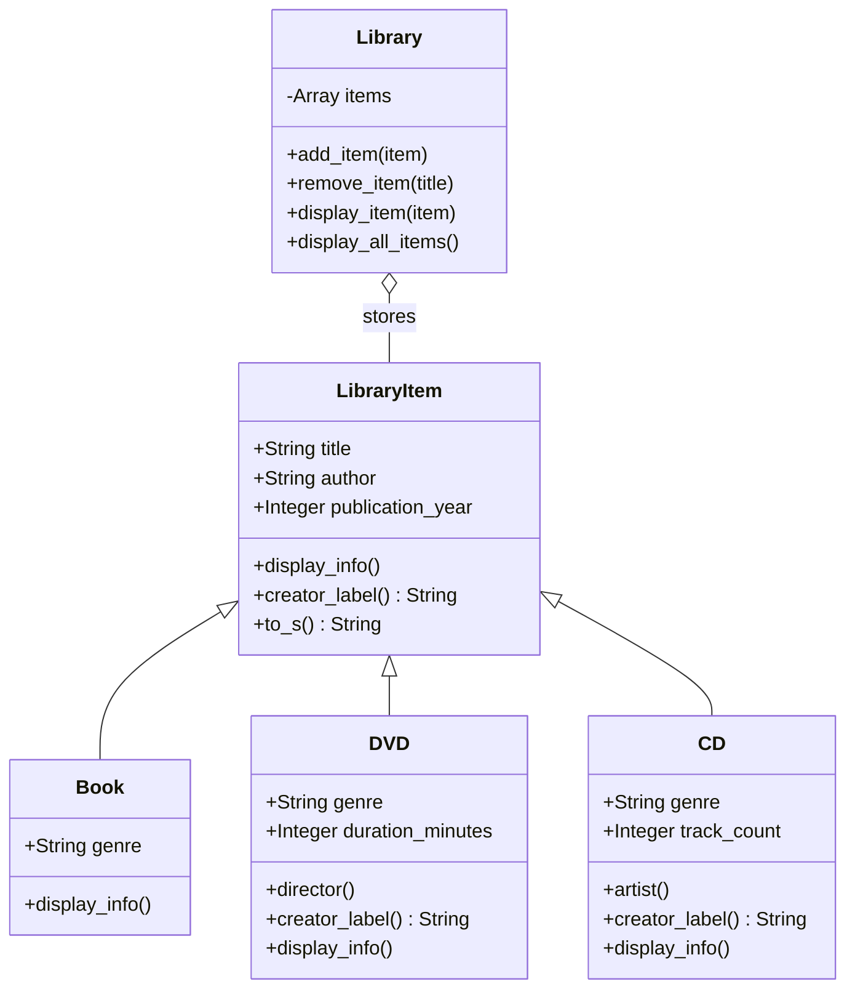

# Task 3: Library Catalog in Ruby (OOP)

A small library catalog that manages different types of items (books, DVDs and CDs).
The task checks four OOP principles: class design, inheritance, encapsulation and
polymorphism.

## Files

| File | Content |
|------|---------|
| `library_item.rb` | base class `LibraryItem` with the common properties |
| `book.rb` | `Book`, extra property: `genre` |
| `dvd.rb` | `DVD`, extra properties: `genre`, optional `duration_minutes`; the author is the director |
| `cd.rb` | `CD`, extra properties: `genre`, optional `track_count`; the author is the artist |
| `library.rb` | `Library`, stores and manages a collection of items |
| `main.rb` | demo script from the task, plus removal of an item |

## How to run

Ruby must be installed (I used Ruby 4.0.7 from RubyInstaller on Windows).

```bash
cd task3
ruby main.rb
```

`main.rb` loads the other files with `require_relative`, so only this file is run.

## Class design



## How the OOP principles are used

**Class design.** Everything shared by all items (title, author, publication year and
the basic output) is in `LibraryItem`. Each derived class only adds what is specific
to its type, so there is no repeated code.

**Inheritance.** `Book`, `DVD` and `CD` inherit from `LibraryItem`. Each constructor
calls `super(title, author, publication_year)` to initialize the common part and then
sets its own properties. In `display_info` the derived classes also call `super`, so
the common lines are printed by the base class and only the extra lines are written
in the derived class.

**Encapsulation.** The properties are instance variables (`@title`, `@genre`, ...)
that are exposed only by `attr_reader`. There are no setters, so an item cannot be
changed from outside after it is created. The constructor of `LibraryItem` also
validates the data: an empty title or author and a wrong year raise `ArgumentError`.
`Library` keeps its list in `@items` and offers only `add_item`, `remove_item` and the
display methods. `add_item` accepts only `LibraryItem` objects.

**Polymorphism.** `Library#display_item(item)` does not check the type of the item.
It only calls `item.display_info`, and Ruby runs the version of the real class. Because
of this, `display_all_items` shows books, DVDs and CDs with the same loop. A new type,
for example `Magazine`, could be added without changing `Library`.
`creator_label` works the same way: the base class returns "Author", `DVD` returns
"Director" and `CD` returns "Artist".

## Design decisions

- The task says a DVD has a director and a CD has an artist, but the test code gives
  the director and the artist in the same position as the author. So for a DVD and
  a CD the author *is* the director or the artist. `director` and `artist` are aliases
  of `author` (`alias_method`), and the label in the output changes with
  `creator_label`.
- The fourth constructor argument is the `genre` in all three classes, as in the test
  code from the task.
- The task text contains some non-ASCII letters (for example in `new` and
  `add_item`). The code uses plain ASCII names: `new`, `add_item`,
  `display_all_items`.
- `remove_item` searches by title (case-insensitive) and removes the first match.
  If nothing is found, it prints a message and returns `nil`.

## Output

```
[Book]
Title: Concepts of Programming Languages
Author: Robert Sebesta
Publication year: 2015
Genre: Programming
[DVD]
Title: Inception
Director: Christopher Nolan
Publication year: 2010
Genre: Science Fiction
[CD]
Title: A Day at the Races
Artist: Queen
Publication year: 1976
Genre: Rock

Added: Book: Concepts of Programming Languages (2015)
Added: DVD: Inception (2010)
Added: CD: A Day at the Races (1976)

Library catalog (3 items)
----------------------------------------
[Book]
Title: Concepts of Programming Languages
Author: Robert Sebesta
Publication year: 2015
Genre: Programming
----------------------------------------
[DVD]
Title: Inception
Director: Christopher Nolan
Publication year: 2010
Genre: Science Fiction
----------------------------------------
[CD]
Title: A Day at the Races
Artist: Queen
Publication year: 1976
Genre: Rock
----------------------------------------

Removed: DVD: Inception (2010)
Item not found: Unknown title

Library catalog (2 items)
----------------------------------------
[Book]
Title: Concepts of Programming Languages
Author: Robert Sebesta
Publication year: 2015
Genre: Programming
----------------------------------------
[CD]
Title: A Day at the Races
Artist: Queen
Publication year: 1976
Genre: Rock
----------------------------------------
```